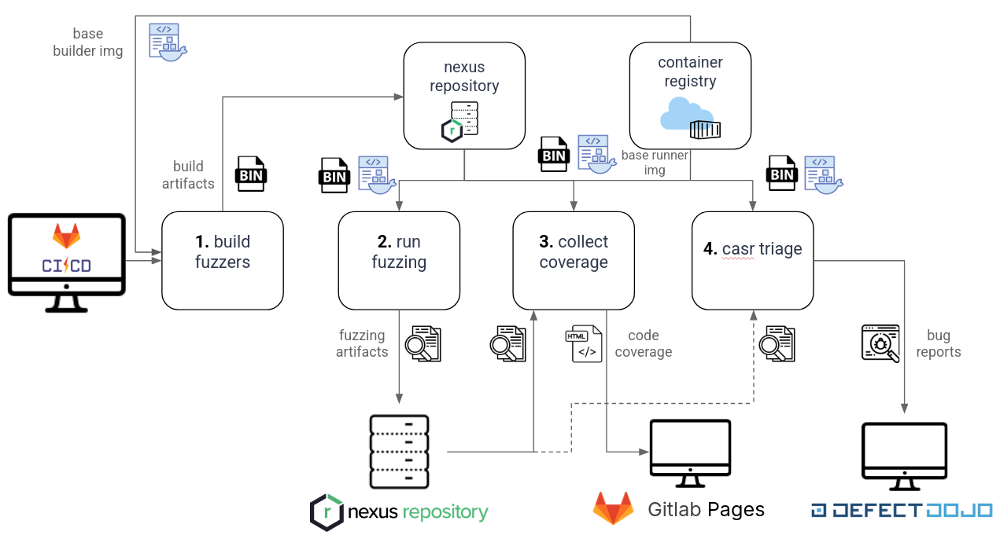

# fuzz-manager

**fuzz-manager** - это форк проекта [oss-fuzz](https://github.com/google/oss-fuzz), который автоматизирует все стадии цикла фаззинга: от сборки проекта до публикации артефактов. В отличие от оригинала, проект делает упор на поддержку инструмента [sydr-fuzz](https://sydr-fuzz.github.io/docs/), добавляет отдельную стадию анализа падений с помощью [casr](https://github.com/ispras/casr) и интегрирует удалённое хранилище **Nexus** для хранения и переиспользования артефактов фаззинга - сборок проектов, наработанного корпуса и собранного покрытия.

---

## Зачем нужен этот инструмент

Данный инструмент появился у нас как результат перехода от ручного запуска фаззинг-итераций к фаззингу в пайплайнах. Оригинальный oss-fuzz - проверенный подход к автоматизации фаззинга, но при локальном использовании он наталкивается на ряд ограничений:

- **Основной инструмент sydr-fuzz не поддерживается.** Инфраструктура oss-fuzz позволяет тестировать целевую программу под разными фаззинг-движками, что позволяет обнаружить уникальные уязвимости, которые один инструмент может пропустить из-за особенностей своего алгоритма. Но при этом каждый фаззер запускается изолированно и не обменивается находками с остальными движками. Sydr-fuzz решает эту проблему в режиме `Ensemble-фаззинг` (для AFL++, LibFuzzer и Sydr).
- **Анализ падений остаётся ручной стадией.** Краши попадают в отчёты в «сыром» виде: их нужно вручную дедуплицировать, классифицировать и расставлять по приоритетам, что занимает значительное время. `Casr` позволяет автоматизировать данный процесс.
- **Локальное использование инфраструктуры.** Инфраструктуру `oss-fuzz` удобно использовать для локального запуска непродолжительного фаззинга или для дебага проблем. Но использование данной инфраструктуры в CI/CD ограничено. Мы используем `fuzz-manager` у себя для запуска фаззинг-итераций в пайплайне.

---

## Основные возможности

### Полный автоматизированный цикл фаззинга

Как и в oss-fuzz, проект покрывает весь цикл: сборка фаззим-цели в Docker-контейнере, запуск фаззеров, сбор покрытия и формирование отчётов [Fuzz introspector](https://github.com/ossf/fuzz-introspector). При этом сохраняется поддержка основных языков программирования: C/C++, Rust, Go, Python, Java/JVM, JavaScript и Lua.

### Поддержка sydr-fuzz

sydr-fuzz - основной рекомендуемый инструмент фаззинга:

- поддержка `Ensemble-фаззинга` в sydr-fuzz с разными сборками;
- генерация конфигурации под sydr-fuzz при описании проекта;
- выбор инструмента фаззинга через простой параметр (возможны и другие инструменты, доступные в oss-fuzz).

### Анализ падений через casr

Отдельная команда `casr` автоматически обрабатывает найденные падения с помощью инструмента [casr](https://github.com/ispras/casr):

- дедупликация и классификация крашей;
- отчёт о уникальных проблемах с приоритизацией;
- возможность публикации отчётов о падении на `DefectDojo`.

### Хранение и переиспользование артефактов в Nexus

Проект поддерживает удалённое хранилище на базе [Nexus](https://www.sonatype.com/products/sonatype-nexus-repository) (Repository Manager), куда публикуются и откуда скачиваются артефакты фаззинга:

- **сборки проектов** - не пересобирать проект, если уже собрана актуальная версия;
- **наработанный корпус** - подхватывать корпус с предыдущих запусков и продолжать фаззинг с достигнутого уровня, а не с нуля;
- **собранное покрытие** - хранить результаты покрытия для анализа динамики и отчётности.

Переиспользование артефактов экономит ресурсы CI, сокращает время запуска и делает результаты фаззинга воспроизводимыми между запусками и между проектами.

---

## Архитектура и схема работы

В нашей компании стандартный пайплайн фаззинг-итерации выглядит следующим образом:



fuzz-manager позволяет удобно реализовать данный пайплайн.

---

## Установка fuzz-manager

```bash
git clone https://github.com/Fobos-NT/fuzz-manager
ln -s $(pwd)/fuzz-manager/infra/helper.py /usr/local/bin/fuzz-manager
```

Для того чтобы настроить URL вашего репозитория Nexus, необходимо переопределить  константы, которые начинаются с `REPOSITORY_`, в начале файла [`fuzz-manager/infra/helper.py`](infra/helper.py):

```python
# Nexus url address
REPOSITORY_BASE_URL = "http://10.10.10.10:8080"
# Nexus repository name to work with
REPOSITORY_NAME = "fuzzing_test"
# Tree structure to use inside of repository to save and download artifacts
REPOSITORY_PROJECT_PATH = "fuzzing/{project}/{archive_filename}"

# Template url for downloading artifacts for a project
REPOSITORY_DOWNLOAD_URL_TEMPLATE = f"{REPOSITORY_BASE_URL}/repository/{REPOSITORY_NAME}/{REPOSITORY_PROJECT_PATH}"

# Template url for uploading artifacts for a project
REPOSITORY_UPLOAD_URL = f"{REPOSITORY_BASE_URL}/service/rest/v1/components?repository={REPOSITORY_NAME}"
```

Если вы используете внешнее хранилище отличное от Nexus, то в файле `fuzz-manager/infra/helper.py` можно переопределить функции `_download_archive` и `_upload_archive`, которые отвечают за работу с удалённым хранилищем артефактов.

---

## Основные команды

Все примеры ниже — базовый синтаксис; полный список флагов доступен через `--help`.

### Генерация базовой структуры проекта

По умолчанию `FM_MODE=work`: команды используют исходники, добавленные в Docker-образ. В режиме `FM_MODE=dev` каждый репозиторий из каталога `sources` монтируется в `/src/<имя-репозитория>`, также локальные `build.sh` и `assets` монтируются в `/src`.

Команда `generate` создаёт базовую структуру проекта, а `add_target` добавляет в существующий проект новую фаззинг-цель. Обе команды выполняются только в режиме `dev`.

```bash
FM_MODE=dev fuzz-manager generate --language=c --target=my_target my_project
FM_MODE=dev fuzz-manager add_target another_target -C my_project
```

В качестве демонстрации использования fuzz-manager используется тестовый проект `fuzz-manager/test_projects/json-parser`.

### Сборка проекта

Артефакты сборки будут находиться в директории `fuzz-manager/test_projects/json-parser/out`.

```bash
# Собрать фаззинг-обёртки с дефолтной конфигурацией (libfuzzer + asan)
fuzz-manager build_fuzzers fuzz-manager/test_projects/json-parser

# Сделать сборку для sydr - инструмента динамической символьной интерпретации, входящего в состав Sydr-Fuzz.
fuzz-manager build_fuzzers --sanitizer=none --engine=sydr-fuzz --clean --use_separate_dir fuzz-manager/test_projects/json-parser

# Сделать сборку под afl + undefined и выложить сборку на Nexus репозиторий
NEXUS_USER=<nexus_username> NEXUS_TOKEN=<nexus_username_password> fuzz-manager build_fuzzers --push --engine=afl --sanitizer=undefined fuzz-manager/test_projects/json-parser
```

Стоит отметить, что для sydr-fuzz необходимо делать сразу все сборки, которые будут использоваться при фаззинге. Чтобы сделать разные сборки в директории `out`, необходимо использовать флаг `--use_separate_dir`. Например, сборки под sydr и libfuzzer + asan:

```bash
fuzz-manager build_fuzzers --sanitizer=none --engine=sydr-fuzz --use_separate_dir fuzz-manager/test_projects/json-parser
fuzz-manager build_fuzzers --sanitizer=address --engine=libfuzzer --use_separate_dir fuzz-manager/test_projects/json-parser
fuzz-manager build_fuzzers --use_separate_dir --engine=afl --sanitizer=none fuzz-manager/test_projects/json-parser
```

### Запуск фаззинга

Результаты фаззинга будут находится в директории `fuzz-manager/test_projects/json-parser/out/json_parse_out`.

```bash
# Базовый запуск фаззинга для цели с дефолтной сборкой (libfuzzer + asan) на 100 секунд
fuzz-manager run_fuzzer --timeout=100 fuzz-manager/test_projects/json-parser json_parse

# Запуск конкретного фаззера в 4 потока с установкой сборки с Nexus
NEXUS_USER=<nexus_username> NEXUS_TOKEN=<nexus_username_password> fuzz-manager run_fuzzer --sanitizer=afl --engine=libfuzzer --pull_build --workers=4 fuzz-manager/test_projects/json-parser json_parse

# Запуск фаззинга через sydr-fuzz с клонированием и последующей выгрузкой артефактов фаззинга на Nexus репозиторий
NEXUS_USER=<nexus_username> NEXUS_TOKEN=<nexus_username_password> SYDR_PATH=<path_to_sydr-fuzz> fuzz-manager run_fuzzer --push_artifacts --pull_artifacts --engine=sydr-fuzz fuzz-manager/test_projects/json-parser json_parse
```

### Сбор наработанного покрытия

Перед сбором покрытия необходимо сделать сборку для сбора покрытия:

```bash
# Собрать фаззинг-обёртки для сбора покрытия
fuzz-manager build_fuzzers --sanitizer=coverage --engine=libfuzzer fuzz-manager/test_projects/json-parser
```

Общий отчёт о покрытии будет находится в директории `fuzz-manager/test_projects/json-parser/out/report`, а отчёты по фаззинг-целям отдельно в директории `fuzz-manager/test_projects/json-parser/out/report_target`.

```bash
# Сбор наработанного покрытия для всех фаззинг целей. Корпус для фаззинг цели должен находиться в директории fuzz-manager/test_projects/json-parser/corpus/<фаззинг-цель>
fuzz-manager coverage --no-corpus-download fuzz-manager/test_projects/json-parser --fuzz-target=json_parse

# Сбор наработанного покрытия для json_parse цели с использованием корпуса с Nexus репозитория и выгрузкой результатов
NEXUS_USER=<nexus_username> NEXUS_TOKEN=<nexus_username_password> fuzz-manager coverage --push_artifacts --fuzz-target=json_parse fuzz-manager/test_projects/json-parser
```

### Анализ падений с помощью casr

Отчёты casr после работы находятся в директории: `fuzz-manager/test_projects/json-parser/out/casr_out`

```bash
# Запустить casr-анализ по результатам завершённого фаззинга
fuzz-manager casr --crash_dir=<crashes_path> --no-crashes-download --engine=libfuzzer --sanitizer=address fuzz-manager/test_projects/json-parser

# Загрузить найденные падения с Nexus репозитория и выложить casr отчёты на DefectDojo
NEXUS_USER=<nexus_username> NEXUS_TOKEN=<nexus_username_password> DD_TOKEN=<defectdojo_api_token> fuzz-manager --fuzz-target=json_parse --push_artifacts --engine=libfuzzer --sanitizer=address --dojo-url=<defectdojo_url> fuzz-manager/test_projects/json-parser
```

### Генерация Fuzz Introspector отчёта

Fuzz Introspector — это инструмент анализа качества фаззинга, который помогает разработчикам оценивать эффективность фаззеров, находить фазз-блоккеры ([статья](https://secure-software.ru/blog/povyshenie-stavok-nakhodim-bagi-kotorye-propustil-oss-fuzz/) об анализе отчёта Fuzz Introspector) и улучшать покрытие кода тестами.

```bash
# Сгенерировать отчёт fuzz introspector на наработанном покрытии с nexus
NEXUS_USER=<nexus_username> NEXUS_TOKEN=<nexus_username_password> fuzz-manager introspector --public-corpora --push_artifacts fuzz-manager/test_projects/json-parser
```

Сгенерированный отчёт Fuzz Introspector находится в директории `fuzz-manager/test_projects/json-parser/out/introspector-report`

## Настройка проекта

Структура описания проекта наследуется от oss-fuzz: для каждого фаззинг-проекта создаётся каталог со своим Dockerfile, build.sh и project.yaml. 

1. [`project.yaml`](https://google.github.io/oss-fuzz/getting-started/new-project-guide/#projectyaml) - содержит основные метаданные по проекту (язык программирования, список санитайзеров)
2. [`Dockerfile`](https://google.github.io/oss-fuzz/getting-started/new-project-guide/#dockerfile) - докерфайл для проекта. Образ должен наследовался от одного из базовых образов из `ghcr.io/fobos-nt/fuzz-manager/`. Названия наших базовых образов полностью совпадают с названиями базовых образов oss-fuzz, необходимо только поменять `gcr.io/oss-fuzz-base/` на `ghcr.io/fobos-nt/fuzz-manager/`. В образе устанавливаются все сборочные зависимости проекта, скачивается исходный код тестируемого проекта, а также в образ в директорию $SRC копируются "build.sh" и артефакты для сборки проекта. По умолчанию собранные обёртки запускаются в базовом образе `ghcr.io/fobos-nt/fuzz-manager/base-runner`, поэтому обёртки должны быть собраны статически. Но есть возможность определить **run** стадию в Dockerfile, чтобы её использовать для запуска обёрток. На стадии **run**  Dockerfile можно устанавливать runtime зависимости.
3. [`build.sh`](https://google.github.io/oss-fuzz/getting-started/new-project-guide/#buildsh) - скрипт по сборке проекта и фаззинг обёрток. Дожен учитывать переменные окружения для сборки. Также скрипт build.sh должен положить **статически** слинкованные (иначе все зависимости должны быть удовлетворены в runtime образе) цели, словари, начальный корпус, конфигурационные файлы для sydr-fuzz в директорию $OUT, чтобы эти артефакты были на стадии **run**.

Подробное руководство по созданию и настройке проектов можно посмотреть в официальной [документации oss-fuzz](https://google.github.io/oss-fuzz/getting-started/new-project-guide/). Существующие проекты oss-fuzz в большинстве случаев поддерживаются с помощью fuzz-manager.

Для того чтобы создать конфигурационный файл для sydr-fuzz, необходимо назвать его как <fuzzer_name>-sydr.toml. Данный конфигурационный файл на этапе сборки должен копироваться в директорию `$OUT` с помощью `build.sh` скрипта. Если на этапе запуска фаззинга конфигурационный файл для sydr-fuzz отсутствует, то fuzz-manager савтоматически попытается сгенерировать конфигурацию для sydr-fuzz на основе имеющихся сборок.

Со структурой проекта можно ознакомиться на тестовом проекте [json-parser](test_projects/json-parser)
